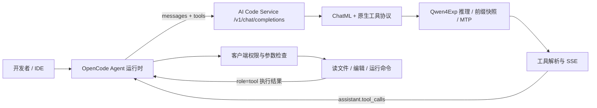
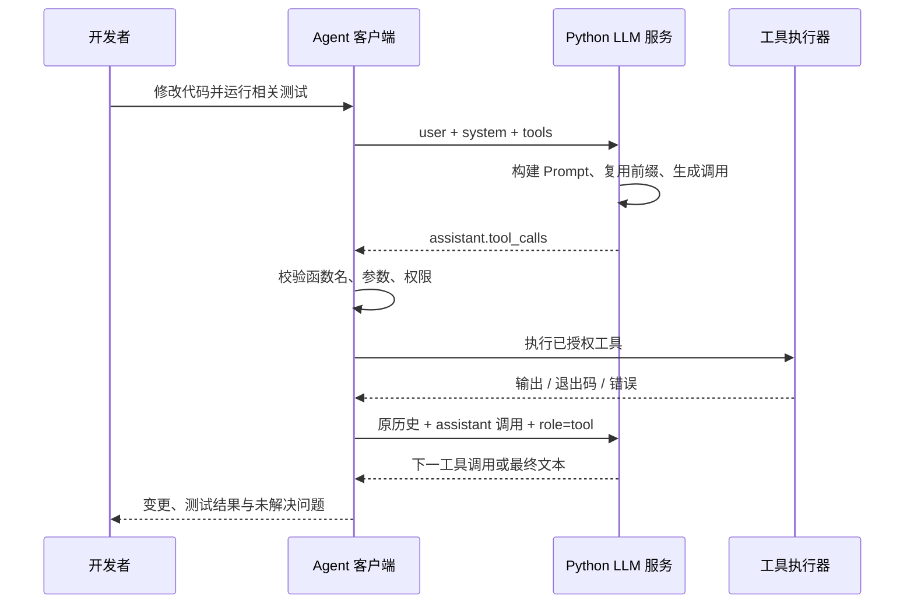

# Code Agent 架构、工具协议与编程能力评测

更新日期：2026-10-14。本文描述当前 AI Code Service 与 OpenCode 的分工、工具循环、推理优化、运行方式和能力评测。模型内部与 API 架构见 [LLM 设计](llm_design.md)，混合缓存的完整实现见 [Qwen4Exp 前缀缓存](QWEN4_PREFIX_CACHE.md)。

## 1. 能否用于编程

项目可以用于代码解释、函数生成、重构建议、Bug 修复、补充测试、FIM 补全，以及通过 OpenCode 读取/编辑文件并运行测试。真实集成测试已经验证可执行代码生成和工具调用结果续接。

需要区分三种能力：

| 层级 | 问题 | 当前证据 |
| --- | --- | --- |
| 模型生成能力 | 生成的函数是否通过断言 | HumanEval / MBPP 逐题评测 |
| 服务与协议能力 | 模型加载、流式、缓存、工具格式是否工作 | 单元/真实集成测试与前缀 benchmark |
| 工程 Agent 能力 | 能否理解仓库、修改多个文件并修复失败 | 需要真实仓库任务和完整工具轨迹评测，不能由函数题推导 |

速度快、工具协议正确或回归测试全通过，均不等于大型项目自动修改成功率高。推荐先用于可运行测试验证的小范围任务；跨文件重构、依赖升级和架构修改需要更强的验收证据。

## 2. 系统边界与组件分工



| 组件 | 负责内容 | 不负责内容 |
| --- | --- | --- |
| OpenCode / IDE 客户端 | 会话、工具注册、权限、实际执行、任务循环、文件变更 | 模型权重加载与混合缓存 |
| Python FastAPI 服务 | Prompt、推理、协议转换、SSE、响应缓存、性能指标 | 自动执行模型输出的命令 |
| Qwen4Exp 引擎 | 模型/tokenizer、完整状态预填充、贪婪 MTP | 工具名字真实性、工具授权 |
| Go Web 网关 | Web 静态文件、部分后端接口代理 | OpenCode 工具执行运行时与完整后端 API 转发 |

服务端输出 `bash`、`write_file` 等函数名并不代表函数已经存在或执行。工具名和参数 Schema 必须由客户端在请求中提供；执行前仍由工具运行时验证。

本服务没有实现 Agent 会话数据库、仓库索引器、自动任务计划器、自动恢复文件变更或服务端工具沙箱。这些职责应由 OpenCode 或其他 Agent 客户端提供。

## 3. 一次完整工具循环



客户端必须保留调用顺序、assistant `tool_calls` 和对应 `tool_call_id`。仅追加工具结果、丢掉 assistant 调用历史，会使模型缺少上下文。当前 Prompt 构建器主要按消息顺序组织结果，不校验调用 ID 与结果的一一对应关系。

服务端的结束标志表示本次生成完成，不保证整个开发任务完成。任务循环是否继续、工具失败后是否重试、何时停止，应由客户端根据执行结果与用户目标决定。

## 4. 请求契约与最小示例

优先使用 `POST /v1/chat/completions`。`/v1/responses` 只是部分输入兼容的路由别名，返回仍是 Chat 结构；不能使用期待 `response.output` 或 `response.*` 流式事件的客户端模式。

```json
{
  "model": "qwen3.8-flash-next-oq4e-mtp-128k",
  "messages": [
    {"role": "system", "content": "先检查当前实现，再做最小修改，并运行相关测试。"},
    {"role": "user", "content": "请读取 src/calculator.py，解释 add 函数的实现。"}
  ],
  "tools": [
    {
      "type": "function",
      "function": {
        "name": "read_file",
        "description": "读取工作区内的文本文件。",
        "parameters": {
          "type": "object",
          "properties": {"path": {"type": "string"}},
          "required": ["path"]
        }
      }
    }
  ],
  "temperature": 0.0,
  "enable_thinking": false,
  "max_tokens": 2048,
  "stream": false
}
```

模型解析成功后，Chat choice 大致为：

```json
{
  "index": 0,
  "message": {
    "role": "assistant",
    "content": "",
    "tool_calls": [
      {
        "id": "call_example",
        "type": "function",
        "function": {
          "name": "read_file",
          "arguments": "{\"path\": \"src/calculator.py\"}"
        }
      }
    ]
  },
  "finish_reason": "tool_calls"
}
```

`function.arguments` 是 JSON **字符串**，客户端需要反序列化。下一轮发送完整历史，再加入：

```json
[
  {
    "role": "assistant",
    "content": "",
    "tool_calls": [{
      "id": "call_example",
      "type": "function",
      "function": {"name": "read_file", "arguments": "{\"path\": \"src/calculator.py\"}"}
    }]
  },
  {
    "role": "tool",
    "tool_call_id": "call_example",
    "content": "def add(a, b):\n    return a + b\n"
  }
]
```

示例的函数名用于说明协议，不是后端内置工具。失败结果应包含实际错误/退出码而不是伪造成功，方便模型决定下一步。

### 4.1 `tool_choice` 的当前行为

| 值 | 当前效果 |
| --- | --- |
| 省略或 `auto` | 非空 tools 注入 Prompt，由模型选择 |
| `none` | 不注入 tools，按普通对话处理 |
| `required` | 字段可接收，但没有强制约束模型必须调用工具的实现 |
| 指定 function 的对象 | 字段可接收，但没有只允许某一个工具的约束实现 |

不能仅依赖 `tool_choice` 确保调用行为，也不能把“模型选择某工具”当成授权。未知工具、缺失必填参数、参数类型不匹配应在客户端执行前拦截。

## 5. OpenAI 工具与 Qwen 原生格式

### 5.1 工具声明

[engine/tool_format.py](../engine/tool_format.py) 将工具 JSON 列表写入系统消息的 `# Tools` / `<tools>` 区域，并加入原生调用格式说明与 Agent 提示。用户系统指令随后附加；普通对话的禁止工具标签指导不会注入该模式。

保持工具顺序、JSON 结构、说明和固定系统指令稳定，有助于跨轮次复用前缀。每轮更改大量工具声明会改变 token 前缀，从而降低命中率。

### 5.2 调用格式

```xml
<tool_call>
<function=read_file>
<parameter=path>
src/calculator.py
</parameter>
</function>
</tool_call>
```

assistant 历史的 `tool_calls` 会被序列化回这个格式。多个调用分别形成调用块，最终由消息顺序拼接；不要将旧注释中的“同一包裹标签内”当成当前序列化行为。

### 5.3 工具结果

```text
<|im_start|>user
<tool_response>
def add(a, b):
    return a + b
</tool_response>
<|im_end|>
```

连续多条 `role: tool` 会合并为一个 user 消息，其中保留多个 `<tool_response>`。这与本项目当前模板约定一致，但未证明任意模型版本的官方模板都与其逐字一致。

### 5.4 容错解析

解析器先处理原生 XML 函数块，再尝试残留调用块中的 JSON：

| 模型输出 | 当前容错 |
| --- | --- |
| 完整 tool_call + function + parameter | 转为标准 `tool_calls` |
| 裸 `<function=...>`，有闭合函数块 | 可以提取 |
| 缺 `</function>` 但以 `</tool_call>` 结束 | 可以提取 |
| tool_call 内 `name` + `arguments` / `parameters` JSON | 可以提取 |
| tool_call 内 OpenAI function JSON 或 JSON 数组 | 可以提取 |
| tool_call 内 JSON Markdown 围栏 | 可以提取 |
| 未闭合、截断参数、任意裸 JSON、错误函数名 | 不保证恢复，也不负责语义正确性验证 |

原生参数如果明显是 JSON 数字、布尔值、数组、对象或带引号字符串，会尝试 `json.loads()`；其他内容作为文本保留。解析完成后生成新的 call ID，不能要求多次同输入请求的 call ID 相同。

代码参数的归一化只移除标签附近有限的换行，不对整段文本 `.strip()`，以减少 Python 首行缩进损坏。它不是任意格式的逐字透明传输：换行包装和 JSON 类型转换仍有约定。

## 6. SSE 协议、工具区域与停止

### 6.1 文本流与工具终帧

普通正文以 `choices[0].delta.content` 返回。在 tools 模式，`StreamRegionFilter` 会跨 chunk 暂存可能未完整到达的标记，过滤思考区与原生调用区。进入工具区后不把参数作为普通正文发送。

原始输出仍由路由累计，流结束后整体解析一次工具调用。因此：**正文可以逐步显示，工具参数要等待最终帧**。当前没有逐 chunk 的工具参数增量协议。

```json
{
  "object": "chat.completion.chunk",
  "choices": [{
    "index": 0,
    "delta": {
      "tool_calls": [{
        "index": 0,
        "id": "call_example",
        "type": "function",
        "function": {"name": "read_file", "arguments": "{\"path\": \"src/calculator.py\"}"}
      }]
    },
    "finish_reason": "tool_calls"
  }],
  "usage": {"prompt_tokens": 400, "completion_tokens": 40, "total_tokens": 440}
}
```

终帧后正常发送 `data: [DONE]`。`tool_calls[i].index` 用于客户端拼接；该示例省略了真实路由还会返回的 id、created、model 字段。

未成功解析到调用时 `finish_reason` 通常为 `stop`；当前路由未完整映射引擎的 length finish reason，所以不能只根据 `stop` 判断输出没有达到上限。语法残缺、参数缺失或 token 预算不足应单独检查。

### 6.2 停止序列

Chat tools 模式把用户 stop 与 `</tool_call>`、`<|im_end|>` 合并。当前不把 `</function>` 作为全局停止词，以免破坏完整函数/参数结构。提前停止会减少调用后的解释性续写；解析器可通过已经闭合的 function 块恢复调用，即便外层关闭标记被停止处理移除。

第一个调用块闭合就可能触发停止，因此不能假设同一响应会并行生成任意多个工具调用。参数本身含有控制标签时也可能提前停止，客户端应避免把这类内容作为原生控制结构直接信任。

### 6.3 错误与取消

流式响应发送 HTTP 头后发生推理异常，服务通过 SSE `error` 对象报告；正常情况下的 `[DONE]` 不意味着异常情况下也一定发送。

后台桥接最多积压 32 个数据块，慢客户端使生产线程等待。客户端断连时路由显式关闭异步生成器，线程在下一次恢复执行/输出边界后关闭同步生成器并释放锁。单个模型前向不能中途取消；非流式任务也没有同等的逐 token 断连保证。

## 7. Code Agent 推理优化

### 7.1 参数与思考旁路

Code Agent 默认温度为 0.0；Qwen4Exp 还会把 ≤0.2 的有效温度映射为贪婪。默认 tools 场景关闭 thinking，显式 true 仍允许思考输出。关闭 thinking 减少生成负担，不是“零延迟”，复杂任务的正确率变化需要评测。

非流式 Code Agent 请求通过流式引擎生成再汇总文本，使停止序列在生成过程中生效，而不是一直生成到上限再截断。

### 7.2 工具轮次与前缀复用

响应缓存与前缀快照不同：tools 请求绕过完整响应缓存以避免重复返回旧决策，但仍可复用系统和工具声明的混合状态。

Qwen4Exp 快照包含线性循环/卷积、PLE 卷积/n-gram、QSA K/V/offset/index keys。在生成前保存、命中时复制，生成和取消只修改请求副本。默认 LRU 为 4 条、每条最多 8192 tokens，单个请求可能占两个或更多边界。

历史重排、清理 assistant 思考内容或修改工具声明会改变 prompt；仅复用实际匹配的保存边界，不强行裁剪循环状态。API 层没有按 session ID 分缓存，复用以模型实例和精确 token 前缀为准。

### 7.3 MTP 与状态恢复

贪婪 MTP 验证 `[current] + drafts`，接受全部草稿后使用额外主干预测；拒绝时恢复完整验证前快照，重放当前 token 和已接受草稿。辅助头状态每轮重建。随机采样和 logits processor 走原生路径。

深度大并不保证更快：拒绝率高时多做草稿、复制和重放。当前样例中的高接受率或 0.124 s 首字不能直接推广到全部编程题。完整算法与真实测量见前缀缓存专项文档。

### 7.4 性能拆解

```text
一次 Agent 回合耗时
  = 客户端上下文准备
  + HTTP 与服务排队
  + 分词 / 前缀恢复 / 增量预填充
  + 模型决策或代码生成
  + 工具参数终帧解析
  + 工具执行与结果整理
```

TTFT 只覆盖其中一部分。工具参数到达时间、一次编辑完成时间、测试执行时间，以及完整任务完成时间更能描述 Agent 体验。提高模型生成速度不一定减少慢构建或大量往返工具调用的时间。

## 8. OpenCode 配置与启动

模板为 [agent/opencode.json.template](../agent/opencode.json.template)，脚本为 [scripts/start-agent.sh](../scripts/start-agent.sh)。关键配置示例：

```json
{
  "$schema": "https://opencode.ai/config.json",
  "provider": {
    "aicodeservice": {
      "npm": "@ai-sdk/openai-compatible",
      "name": "AI Code Service",
      "options": {"baseURL": "http://localhost:1235/v1", "apiKey": "not-needed"},
      "models": {
        "qwen3.8-flash-next-oq4e-mtp-128k": {
          "name": "Qwen4Exp local coding model",
          "limit": {"context": 131072, "output": 8192}
        }
      }
    }
  },
  "model": "aicodeservice/qwen3.8-flash-next-oq4e-mtp-128k",
  "small_model": "aicodeservice/qwen3.8-flash-next-oq4e-mtp-128k",
  "temperature": 0.0
}
```

模板目前还把 edit、bash、read、glob、grep、webfetch、todowrite 配成 allow；这表示客户端实际授权策略，不是“这些命令天然安全”。项目当前沿用该配置，本文不替用户改变权限。

`small_model` 与主模型相同，所以标题、轻量分析等请求不代表额外加载了更小的模型。131072/8192 是客户端预算声明，不代表服务已验证极限上下文或会自动保留输出预算。

### 8.1 一键服务流程

```bash
./scripts/start-agent.sh
```

脚本加载 `.env`、激活 Conda、检测或安装 opencode、检查 Python 后端可达性，必要时启动后端，然后将模板中的后端地址和模型名替换生成 `agent/opencode.json`，最后启动 `opencode serve`。

| 配置/资产 | 默认值或行为 |
| --- | --- |
| `PORT` / `BACKEND_URL` | 后端默认 1235；provider 使用其 `/v1` |
| `DEFAULT_MODEL` | 默认 Qwen4Exp 模型 ID |
| `OPENCODE_HOST` / `OPENCODE_PORT` | 默认 `0.0.0.0:4096` |
| 后端日志 | `/tmp/aicode-backend.log` |
| Agent 日志 | `/tmp/aicode-agent.log` |
| 生成配置 | `agent/opencode.json`，每次脚本启动会重新生成 |
| Agent 密码 | 未提供 `OPENCODE_SERVER_PASSWORD` 时保存/读取 `agent/.opencode-password` |

脚本检测 `/health` 可达，不等同于确认真实权重/生成已经就绪。按 LLM 文档检查 `active_engines`、`engine_stats.loaded`，并发送小请求验证。

后端启用 API Key 时，模板里的 `not-needed` 不会自动替换成真实 key，需要使客户端 provider 配置与后端相符。OpenCode Basic Auth 与 Python Bearer Key 是两个不同入口的鉴权，不能混用。脚本当前在未设置密码时即生成密码，包括回环监听；不要把提示日志中的“非回环”理解为完整行为。

### 8.2 CLI 与停止

```bash
cd agent
opencode
```

启动脚本在收到 Ctrl+C 时结束自己的 Agent 子进程，并仅停止它自行拉起的后端；原本已经运行的后端会保留。`./scripts/stop-all.sh` 使用项目 PID/端口管理逻辑停止服务，其作用范围比单个 Agent 脚本更广。

## 9. 编程能力评测的定义

### 9.1 完整成绩的验收

完整评测要求所有预期任务都有一份实际生成输出、组装代码和终态测试结果：

```text
HumanEval: expected_total = 164
MBPP: expected_total = 974
completed_generation_and_test == expected_total
infrastructure_errors == 0
missing == 0
complete == true
```

测试断言失败、SyntaxError、运行异常或测试超时是模型样本的测试失败，应计入一次通过率；连接失败、HTTP/服务故障导致根本没有生成/测试，则不是有效能力样本，必须恢复后补齐。

一次成功生成后的失败题不重采样、不根据测试结果让模型修复，才能解释为当前协议下的单次通过率。请求错误可以重试，但要记录次数；超时后若服务已生成而客户端未收到，无法完全排除重复生成，因此固定贪婪参数和禁用响应缓存有助于限制统计歧义。

### 9.2 数据与测试协议

| 套件 | 规模 | 输入与测试 | 不代表什么 |
| --- | ---: | --- | --- |
| [eval_coding.py](../agent/eval_coding.py) | 10 个内置任务 | 典型函数任务、生成后执行断言 | 完整工程 Agent 评分 |
| HumanEval | 本地 164 题 | 函数签名/docstring，官方任务 test 的 check(candidate) | 最新隐藏增强测试集或仓库任务 |
| MBPP | 本地 974 题 | 题目描述及公开 `test_list` 同时提供给模型，生成后执行 setup 和该测试列表 | 无测试提示的 MBPP、MBPP+ 或正式排行榜可比成绩 |

HumanEval 关键词分类只是项目本地观察维度；MBPP 按 task ID 分为 1–300、301–600、601–974，也不能当成经过标定的正式难度分级。

代码围栏会被提取。HumanEval 在模型只返回函数体时用任务 prompt 组装，在返回完整函数时补上 prompt 中的导入；MBPP 直接使用提取的代码。这个组装规则必须随报告披露，不能悄悄针对单题修复代码。

测试在独立 Python 子进程与临时工作目录执行，使用测试超时终止卡住的样本；这减少工作区干扰，但不是操作系统级安全沙箱。生成代码测试是显式评测行为，与在线模型服务直接执行任意工具不同。

### 9.3 历史记录的正确解释

历史 [HumanEval 汇总](../agent/eval_results/humaneval_summary.json) 为 108/164（65.85%），但逐题记录中 55 题是请求失败，只有 1 题是完成生成后的代码测试失败。历史 [MBPP 汇总](../agent/eval_results/mbpp_summary.json) 为 0/300，全部 300 题因后端连接失败未完成生成。

这些数据说明旧评测发生服务中断，不能用 MBPP 0% 推断模型不会编程，也不能只剔除中断题后把部分题通过率当成完整成绩。历史记录缺少当前版本完整环境/配置证据，不能替代本轮优化版本的重测。

### 9.4 当前全量运行与恢复

全量运行器 [run-full-coding-eval.py](../scripts/run-full-coding-eval.py) 只管理自己的独立本地后端，使用真实默认 Qwen4Exp、temperature=0、max_tokens=2048、响应缓存关闭、单并发、MTP/前缀参数记录到配置。与普通服务使用不同端口，历史评测目录不覆盖。

```bash
conda run -n llmqwen python -u scripts/run-full-coding-eval.py \
  --output-dir agent/eval_results/full-local \
  --port 1247
```

直接使用已有后端时：

```bash
conda run -n llmqwen python -u agent/eval_humaneval.py \
  --dataset all --mbpp-tier-size 0 --temperature 0 --max-tokens 2048 \
  --base-url http://localhost:1235/v1 \
  --output-dir agent/eval_results/full-local
```

直接运行前应自行确认真实引擎就绪、关闭响应缓存，并配置所需后端参数；评测脚本当前请求头不内置 Bearer Key 参数。`--mbpp-tier-size 0` 才是完整 974 题，默认 100 是每层抽样。

`--resume` 现在只跳过已完成生成/测试的记录，包括代码失败；请求失败记录会重跑。同一 uid 以最新记录汇总，设置不一致时拒绝恢复。请求错误导致当前 dataset 停止，完整性为 false，CLI 以非零状态退出；监督器可以重启自己后端并继续。单个代码失败不会触发重新生成。

### 9.5 报告资产

| 文件 | 内容 |
| --- | --- |
| `manifest.json` | 数据集哈希、Python/依赖版本、运行参数 |
| `run_metadata.json` | 实际配置、模型/自定义代码哈希、来源代码哈希、重启次数、内存与运行完成状态 |
| `humaneval.jsonl` / `mbpp.jsonl` | 每题原始输出、组装代码、通过状态、测试错误、生成耗时、token 数、请求次数 |
| `*_summary.json` | 预期/完成/缺失/基础设施错误、一次通过率、分组结果、失败列表 |
| `backend.log` | 模型加载与服务错误定位 |

没有完整性校验、只观察终端脚本退出或部分题目通过，均不能视为完整成绩。完整性能报告还应区分生成耗时、测试耗时、HTTP 排队、冷启动与缓存命中；当前脚本的 TPS 为 completion tokens / 非流式请求耗时，不能直接当成引擎纯解码 TPS。

### 9.6 当前实际成绩（2026-10-14）

用户要求停止剩余题目后，冻结实际生成与测试记录，共完成 574 题：

| 数据集 | 完成/全量 | 首次通过 | 已测通过率 | 完整性 |
| --- | ---: | ---: | ---: | --- |
| HumanEval | 164/164 | 159 | 96.95% | 全量完成 |
| MBPP | 410/974 | 334 | 81.46% | 顺序执行前 410 题，剩余 564 题未测试 |

已完成记录没有请求错误或测试超时，代码失败没有重新采样。运行状态为 `stopped_by_user`；MBPP `complete=false`，不能把阶段成绩当作全量结果。分类、性能、失败原因、运行参数和原始证据见 [编程能力评测报告](CODING_EVAL_REPORT.md)。

本轮支持“函数级 Python 编程助手能力较强”的判断，但参数语义、边界、返回顺序与生成截断仍需测试验收；没有评测 OpenCode 跨文件工程任务的自主成功率。MBPP 公开测试包含在提示中，不能直接对标无测试提示的排行榜。

## 10. 工程编程能力的进一步评估

函数题全量完成后，需要另外构建可重复的仓库任务集，才能评价“自动编程”而不仅是“函数解题”。建议覆盖：

| 任务类型 | 验收方式 |
| --- | --- |
| 修复可复现 Bug | 失败测试转绿、原有测试不退化 |
| 添加 API 或 CLI 功能 | 行为测试、参数/错误处理、文档同步 |
| 跨文件重构 | 公开接口与行为保留、类型检查/测试通过 |
| 补测试 | 覆盖实际边界而非只重复实现 |
| 依赖/兼容性修复 | 可重现环境、构建与版本矩阵 |
| 性能优化 | 相同输入的正确性与运行时间对比 |

应保存起始提交、任务描述、工具列表与权限、完整消息/工具轨迹、最终 diff、测试命令和退出码、人工审查意见。指标包括任务成功率、首次修改成功率、总回合数、工具失败率、完成时间，以及需要人工干预的比例。

不要把修改测试以迎合错误实现、未经验证声称通过、或仅生成一段建议当作仓库任务成功。仓库评测完成前，应把当前项目定位为可验证的本地编程助手，而不是已证明能可靠独立完成任意软件项目的 Agent。

## 11. 调优、排查与当前限制

- 工具 Schema 或系统提示词频繁变动：先稳定声明和顺序，再看前缀命中。
- 只出现工具 XML 正文、客户端不执行：检查最终 `tool_calls`、函数名、arguments JSON、客户端注册和权限。
- 流式工具迟迟不调用：当前需等完整调用生成并到达终帧，不能用正文 TTFT 代表工具决策延迟。
- 残缺参数：检查输出预算、停止序列和真实原始输出；不要自动执行无法校验的参数。
- 后端可达但生成失败：健康检查不代表权重就绪，检查实际引擎类型、loaded 与模型日志。
- 评测总分异常偏低：先分离请求失败与代码失败，确认所有题目完成，不因失败大量重采样。
- 首字快但任务慢：检查命令/构建耗时、上下文准备、模型往返次数，而不仅看 MTP TPS。

尚未验证完整 Responses 协议、强制 tool_choice、工具参数增量流、128K 极限输入、多个大型模型并发显存安全或完整跨仓库工程成功率。这些边界应作为后续实现和验收项目。
