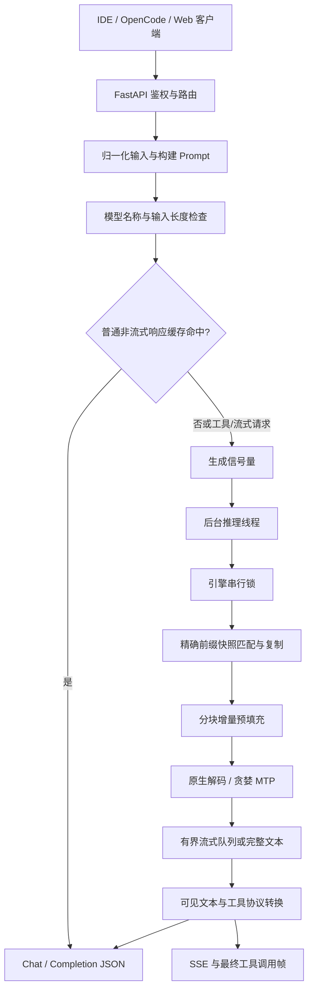

# LLM 服务、推理引擎与缓存设计

更新日期：2026-10-14。本文以当前代码为准，介绍 API 到真实模型的完整路径；工具协议与开发者工作流详见 [Code Agent 设计](code_agent_design.md)，完整混合状态缓存算法见 [Qwen4Exp 前缀缓存](QWEN4_PREFIX_CACHE.md)。

## 1. 项目定位与能力边界

AI Code Service 是运行在 Apple Silicon 上的本地编程模型服务，负责 Prompt 构建、模型推理、文本补全、工具调用格式转换和性能监控。它为 OpenCode、IDE 插件及 Web 客户端提供服务；文件编辑、命令执行、Agent 会话持久化由客户端或 OpenCode 负责。

| 能力 | 当前实现 | 边界 |
| --- | --- | --- |
| 文本对话与代码生成 | Chat JSON / SSE | 代码正确性需要运行测试验证 |
| FIM 代码补全 | 前缀 + suffix 构建 Qwen FIM 标记 | prompt 列表当前只使用第一项，不是批量补全 |
| 编程快捷操作 | 解释、重构、补测试、修复、编辑、审查、docstring | 生成建议或代码，不直接改文件 |
| 工具调用 | OpenAI tools 与 Qwen XML 转换 | 不执行工具；不替代客户端权限检查 |
| Responses 路由 | 接收 `input` / `instructions` 等部分字段 | 返回 Chat 数据结构，不是完整 Responses API |
| 多模型配置 | 模型注册、延迟加载、显式卸载 | 没有自动按显存预算调度或淘汰模型 |
| 长上下文 | 默认 Qwen4Exp 配置为 131072 tokens | 元数据上限不等于已验证该长度的性能/内存安全 |

使用 OpenAI-compatible 客户端时优先选择 `/v1/chat/completions`。当前 API 主要处理文本，不能因存在 mlx_vlm 后端而推断 HTTP 接口支持完整图片/视频输入。

## 2. 组件与职责

| 文件 | 职责 |
| --- | --- |
| [app.py](../app.py) | 配置、FastAPI lifespan、API Key、CORS、请求追踪、默认模型加载 |
| [config.py](../config.py) / [config.yaml](../config.yaml) | Pydantic 配置、模型规格、环境覆盖、性能参数 |
| [schemas/openai.py](../schemas/openai.py) | 请求/响应对象和字段范围 |
| [routers/chat.py](../routers/chat.py) | 输入归一化、采样默认值、停止序列、Chat / SSE 输出、工具解析 |
| [routers/completions.py](../routers/completions.py) | 普通补全与 FIM |
| [routers/code.py](../routers/code.py) | 将编程任务包装为 Chat 请求 |
| [engine/manager.py](../engine/manager.py) | 引擎实例、Prompt 构建、生成信号量、响应缓存、指标聚合 |
| [engine/base.py](../engine/base.py) | 同步生成到异步线程/队列的桥接 |
| [engine/qwen4_exp_engine.py](../engine/qwen4_exp_engine.py) | 自定义模型代码注册、混合缓存预填充、原生解码、贪婪 MTP |
| [engine/mlx_engine.py](../engine/mlx_engine.py) | 通用 mlx_lm / mlx_vlm 加载、生成、标准 KV 参数 |
| [engine/cache.py](../engine/cache.py) | 线程安全响应 LRU + TTL |
| [engine/prefix_cache.py](../engine/prefix_cache.py) | 有界、独立副本的 Qwen4Exp 前缀快照 LRU |
| [engine/tool_format.py](../engine/tool_format.py) | 工具声明、调用/结果序列化、XML/JSON 解析、流式区域过滤 |
| [routers/health.py](../routers/health.py) | 健康检查、JSON 指标、显式模型卸载 |



## 3. 配置与启动生命周期

### 3.1 配置来源

`load_config()` 无参数时读取项目根目录的 `config.yaml`；显式传入路径时使用该路径。`create_app()` 当前默认显式传入 `"config.yaml"`，启动脚本会先切换到项目根目录。

项目根目录 `.env` 由 python-dotenv 加载，`override=False` 保留已有进程环境变量。当前 Python 配置加载器显式识别的覆盖项为 `HOST`、`PORT`、`API_KEY`、`DEFAULT_MODEL`、`USE_MOCK`、`ENABLE_CACHE`；不能把每一个 YAML 性能字段都当成已经有同名环境覆盖。

端口、并发数、流式聚合块大小、缓存容量/TTL、模型上下文长度有取值校验。性能参数在引擎创建时传入；修改配置后需要重启或重新创建引擎。

### 3.2 加载和启动探针

`create_app()` 创建共享 `ModelManager`，FastAPI lifespan 在非 Mock 模式下调用默认引擎 `load_model()`。这会加载权重与 tokenizer；没有执行一条真实生成，因此不等于 Metal kernel、首字路径和前缀缓存都已经预热。

启动加载失败会记录错误，但当前 lifespan 不因此终止整个服务。`/health` 返回的 `status: "ok"` 表示 HTTP 服务响应，不能单独证明模型已经可用。真实就绪检查至少需要确认：

```text
health.use_mock == false
health.active_engines[目标模型] == true
metrics.performance.engine_stats[目标模型].loaded == true
metrics.performance.engine_stats[目标模型].engine_type == "qwen4_exp"
```

正式性能测试还应执行真实生成并单列首次 kernel warmup 的耗时。

### 3.3 引擎选择与回退

- `use_mock: true` 时，manager 为模型创建 `MockModelEngine`。
- `engine_type: qwen4_exp` 选择专用引擎。
- 其他类型交给通用 MLX 引擎；`auto` 可尝试 mlx_lm 与 mlx_vlm，显式类型按其允许的路径加载。
- manager 的构造阶段异常可以回退 Mock；后续权重加载异常与构造阶段异常是不同阶段，不能假设所有加载失败都会自动回退。
- 生产路由对未注册模型返回 404；manager 单独调用时有默认模型/Mock fallback，测试必须检查实际引擎类型。

Qwen4Exp 先从本地路径、ModelScope、Hugging Face、LM Studio 缓存解析模型，再把模型提供的 `omlx_support` 注册到 `mlx_lm.models`。模型代码注册是进程级单例，不应假设不同模型路径的同名自定义代码可以热切换。当前实现使用内置 MoE MTP 层，不依赖普通 27B 模型的外置 238MB draft 头。

### 3.4 卸载与关闭

`POST /admin/unload/{model_name}` 从 manager 删除引擎并调用 `unload_model()`。Qwen4Exp 在锁内清空权重、tokenizer、生成函数、前缀快照与 token 计数缓存，然后清理 Metal 空闲内存池并进行 GC。真实 benchmark 已验证卸载后的前缀条目/计数归零。

当前 FastAPI lifespan 退出只打印关闭日志，没有逐一调用引擎卸载；进程终止由系统回收资源。显式卸载与正在生成的请求共用引擎锁，可能等待生成完成。没有跨模型自动内存预算或闲置模型回收器。

## 4. 请求契约与 Prompt 构建

### 4.1 路由清单

| 方法 | 路径 | 行为 |
| --- | --- | --- |
| POST | `/v1/chat/completions`、`/chat/completions` | Chat JSON / SSE，支持 tools |
| POST | `/v1/responses`、`/responses` | 部分输入兼容的 Chat 路由别名 |
| POST | `/v1/completions`、`/completions` | 文本补全 / FIM JSON / SSE |
| POST | `/v1/code/{operation}` | `explain`、`refactor`、`generate-tests`、`fix-bugs`、`edit`、`review`、`docstring` |
| GET | `/v1/models`、`/models` 及模型详情路径 | 已配置模型元数据，不触发下载或保证加载成功 |
| GET | `/health`、`/v1/health` | 服务状态与引擎健康布尔值 |
| GET | `/metrics` | JSON 运行指标，不是 Prometheus 文本格式 |
| POST | `/admin/unload/{model_name}` | 显式释放已注册引擎 |

Chat 输入优先使用 `messages`，否则处理 `input`；`instructions` 可作为系统消息加入。空输入最终仍构造空 user 消息。HTTP messages 的 `content` 当前 schema 为字符串或 null；`normalize_content()` 存在文本 parts 处理逻辑，不代表完整多模态协议已开放。

### 4.2 ChatML 和系统消息

`build_chat_prompt()` 从消息中提取系统内容，普通角色按 `<|im_start|>role\n...<|im_end|>` 拼接，并追加 assistant 起始段。

- 普通对话使用用户系统消息或配置默认系统提示词；用户系统内容可能追加禁止工具标签等指导约束，这不是权限执行器。
- tools 非空时，系统段以工具声明、XML 格式说明和 Agent 说明开头，再附加用户系统指令，不添加普通对话的防工具标签约束。
- assistant 历史中的 `tool_calls` 序列化为原生调用块；历史思考标签会被清理。
- 连续 `role: tool` 聚合为一个 user 块，其中保留多个 `<tool_response>`。
- 模板主要按消息顺序工作，不进行工具 ID 完整性验证，也不强制执行工具 JSON Schema。

`enable_thinking: false` 使 Prompt 以空 `<think>\n\n</think>\n\n` 结束，减少再次展开思考的输出。省略该字段且启用 Code Agent 或 tools 时，路由默认关闭 thinking；显式 true 保留思考模式。这个设置减少生成工作量，但不能消除分词、排队和模型前向耗时。

### 4.3 FIM 与输出长度

提供非空 suffix 时：

```text
<|fim_prefix|>{prefix}<|fim_suffix|>{suffix}<|fim_middle|>
```

没有 suffix 时直接使用 prefix。非流式 `echo` 可以在普通补全输出前拼接原 prefix；FIM 不进行此拼接。当前不实现完整多样本批量补全。

Chat 输出预算优先级为 `max_output_tokens > max_tokens > 2048`；Completion 默认 512。当前长度检查只比较输入 token 数与模型上下文上限，没有提前验证“输入 + 输出预算”的总和。token 计数在 tokenizer 未就绪或失败时可能使用估计值，因此不能当成所有后端上的严格资源预算。

### 4.4 采样与兼容字段

Chat 显式 temperature 优先，否则 Code Agent 使用配置默认值 0.0，普通对话使用 0.7；Completion 普通默认值为 0.2。Qwen4Exp 在 Code Agent 模式下还会把有效温度 ≤0.2 映射为 0.0。

`top_p` 会传给采样器。`seed` 会经过路由并进入响应缓存键，但 Qwen4Exp 当前没有显式设置随机种子的实现；已有确定性测试使用 temperature=0，不能据此声称随机采样的 seed 保证。presence/frequency penalty 虽可接收，路由未转换为引擎 logits processor。`tool_choice` 的强制选择边界见 Code Agent 文档。

## 5. 三类缓存与语义

| 缓存 | 保存对象 | 命中条件 | 容量/过期 | 适用范围 |
| --- | --- | --- | --- | --- |
| 响应缓存 | 完整输出文本与生成 token 计数 | 模型、Prompt、精确采样参数、stop、seed、输出长度等一致 | LRU，默认 1024 条 / 3600 秒 | 普通非流式；tools 请求绕过 |
| Qwen4Exp 前缀快照 | 生成前完整混合状态 | token 前缀完全匹配、至少留下一个 token | LRU，默认 4 条，每条 ≤8192 tokens | 原生流式、Code Agent 非流式、贪婪 MTP |
| Metal 内存池 | MLX 空闲张量分配空间 | 运行时分配策略 | `metal_cache_limit_mb` 默认 8192 MiB | 与模型语义缓存无关 |

响应 TTL 使用单调时钟；TTL=0 不过期，容量=0 不保留条目。缓存键不把温度或 top_p 舍入到两位小数。响应缓存默认没有限定只缓存贪婪请求，因此随机请求参数相同时可能返回已有样本；测代码生成能力或随机性时应关闭响应缓存。

`enable_cache` / `ENABLE_CACHE` 控制响应缓存；`enable_prompt_cache` 控制前缀状态复用。`X-Cache` 只描述响应缓存，不能表示前缀是否命中。

通用 MLX 引擎的同名开关不能直接视为已具有 Qwen4Exp 的完整快照实现；本文中的跨请求混合状态复用限定为 Qwen4Exp 路径。

## 6. Qwen4Exp 前缀快照与预填充

### 6.1 必须保存的状态

| 状态 | 本地结构 |
| --- | --- |
| 线性注意力卷积与循环 | `ArraysCache[0]` / `[1]` |
| PLE 卷积与 n-gram 历史 | `ArraysCache[2]` / `[3]` |
| QSA K/V、offset、索引 keys | 完整 `QSAKVCache` 对象 |

前缀状态在保存和命中时都 deepcopy；生成只修改副本。不能把上次生成后的状态直接复用，也不能仅裁剪 K/V 假装恢复线性状态。前缀 LRU 有自己的短锁，允许指标读取而不用等待整段模型生成。

### 6.2 精确匹配、边界和容量

设当前输入 tokens 为 `P`，存储前缀为 `S`，只有 `S == P[:len(S)]` 且 `len(S) < len(P)` 才可命中。选择最长有效 S，复制其完整状态，分块处理剩余前缀，再把最后一个输入 token 交给解码器。

系统消息结束、prompt 倒数一个 token、超长输入的 token 上限处是候选快照边界。系统边界也必须通过 token 前缀校验。任意消息分支可回到已保存的系统边界，但不会重建尚未存储的任意公共前缀状态。

缓存以模型引擎为单位共享，不按会话 ID 分组；4 条快照不等于 4 个会话。单快照 token 上限不限制请求上下文。`state_bytes` 只统计持久快照，工作副本和 MTP 验证前副本会有额外成本。模型上下文、缓存容量、Metal 空闲池上限是三个独立概念。

### 6.3 自定义缓存与量化

Qwen4Exp 不注入标准 `kv_bits` / `kv_group_size`，不能套用普通 27B 模型的 8-bit KV 显存估计。`prefill_step_size` 在 `_prepare_prefix()` 内实际控制分块；完整输入仍需要分词。

## 7. 贪婪 MTP 验证

Qwen4Exp 只在有效 temperature=0、存在 MTP、深度>0、无 logits processor 时走 MTP。随机采样和需要 logits 后处理的请求走原生路径。

```text
验证输入: [current, draft0, draft1, draft2]
logits[0] 预测 draft0
logits[1] 预测 draft1
logits[2] 预测 draft2
logits[3] 是全部接受后的额外主干预测
```

全部草稿通过时一次接受多个 token；第 A 个位置出现分歧时，恢复验证前完整主干快照，重放 `[current] + drafts[:A]`，再输出该位置的主干预测。MTP 辅助缓存每个周期重建，不跨周期/请求保存。

这解决了旧代码验证位置错位、PLE 回滚不完整的问题。深度 1/2/3 的真实输出已与原生贪婪样例对比一致；浮点分块差异仍可能影响接近并列的 logits，不能推广为所有输入逐位等价。深度越大，草稿和拒绝重放成本也越高。

## 8. 并发、SSE、背压与取消

非流式通过 `asyncio.to_thread()` 执行同步生成。流式用后台生产线程、有界 `asyncio.Queue(maxsize=32)` 和线程安全发布桥接。生产线程按 `stream_chunk_size` 聚合；队列满时等待，而不是无限积压。

三层约束分别是服务生成信号量、每引擎串行锁、流式队列背压。单个引擎的模型/tokenizer/混合状态必须串行操作；`max_concurrency: 3` 不代表单模型 GPU 并行推理或连续批处理，也不是 OOM 保证。

路由使用 `aclosing()` 显式关闭异步 token 流。取消标志通知生产线程退出，生成器在生产线程关闭以释放锁；已经执行中的模型步骤不能被中途强制终止。若线程正在等待引擎锁，退出也要等到该线程有机会恢复执行。非流式线程任务没有同等的逐 token 断连传播保证。

HTTP 已发送 SSE 头之后的错误以 SSE `error` 对象返回，不能再改 HTTP 状态码。正常 Chat 流的结尾包含 usage 与 `[DONE]`；工具参数在最终帧整体返回，不是逐 token 参数流。

## 9. 可观测性与故障处理

实际 HTTP `/metrics` 的引擎路径是：

```text
performance.engine_stats[model_name]
```

`ModelManager.get_metrics_report()` 内部键名为 `engines`，不能将内部结构与 HTTP 输出混用。

| 指标 | 用途 / 限制 |
| --- | --- |
| `performance.cache` | 响应 LRU 命中、miss、大小、TTL |
| `performance.metal_memory` | 进程级活跃/空闲池/峰值内存，字段 `_mb` 实际按 MiB 换算 |
| `engine_stats.*.loaded` / `engine_type` | 判断真实加载与具体后端 |
| `prefix_cache.*` | 条目、命中、复用 tokens、状态字节数 |
| `last_reused_tokens` | 最近请求跳过的输入计算 |
| `last_prefill_seconds` | 恢复、手动预填充和快照保存，不是端到端 TTFT |
| `mtp_drafted_tokens` / `mtp_accepted_tokens` | 累计接受率；短样例不能推广到全任务 |
| `last_prompt_tps` / `last_generation_tps` | 最近路径报告值，不是并发系统吞吐 |
| `X-Request-ID` | 请求追踪 ID，与 Chat completion ID 不同 |
| `X-Process-Time` | 中间件返回响应前耗时；SSE 不包含完整流消费时间 |

HTTP 401 表示 Bearer token 问题；404 表示未注册模型；400 可表示输入过长；Pydantic 校验失败通常为 422；非流式生成错误为 500。`/metrics`、健康探针和 API 文档目前在鉴权公开路径中，不应误认为配置 API Key 就保护了所有路由。

API Key 是模型服务鉴权，OpenCode Basic Auth 是另一层，均不是工具执行权限。

## 10. 配置建议与实际测量

```yaml
performance:
  enable_cache: true
  cache_max_size: 1024
  cache_ttl_seconds: 3600
  max_concurrency: 3
  metal_cache_limit_mb: 8192
  clear_cache_after_generation: false
  stream_chunk_size: 1
  prefill_step_size: 2048
  enable_prompt_cache: true
  prompt_cache_max_entries: 4
  prompt_cache_max_tokens: 8192
  enable_mtp: true
  mtp_depth: 3
  code_agent_mode: true
  default_temperature: 0.0
```

调优时先保证真实加载和输出正确，再比较同一输入的 kernel warmup、无缓存、首次快照、命中快照。响应缓存应在能力评测中关闭；不要为提高 TTFT 盲目增大 stream_chunk_size，第一块会等待更多输出。

2026-10-13 单次真实测量：

| 场景 | tokens / 复用 | 无前缀 TTFT | 有前缀 TTFT |
| --- | --- | ---: | ---: |
| 重复请求，原生解码 | 790 / 789 | 3.148 s | 0.267 s |
| 用户分支、系统共享 | 790 / 764 | 3.200 s | 0.394 s |
| 多轮历史追加 | 843 / 764 | 3.262 s | 0.567 s |
| MTP + 已有前缀 | 790 / 789 | — | 0.124 s |

权重加载 14.575 s，首次 kernel warmup 首字 12.862 s，新建快照首字 4.631 s。峰值活跃内存约 90 GiB；本机专用环境为 Python 3.13.15、MLX 0.32.1、mlx-lm 0.31.3、transformers 5.14.1。输入范围、32-token 输出上限与单样本限制见 [原始测量](benchmarks/qwen4-prefix-cache-2026-10-13.json)。速度测试不能替代代码能力评分。

## 11. 测试、评测与演进边界

```bash
conda run -n llmqwen python -m pytest tests \
  --ignore=tests/test_real_model_integration.py -q --capture=fd
RUN_REAL_MODEL_TESTS=1 conda run -n llmqwen python -m pytest \
  tests/test_real_model_integration.py -q --capture=fd
conda run -n llmqwen python -u scripts/benchmark-prefix-cache.py \
  --output docs/benchmarks/qwen4-prefix-cache-local.json
```

已验证的回归包括缓存参数隔离、TTL、LRU、完整状态副本、取消、背压、真实代码生成、FIM、工具循环及 MTP 深度对比。没有完成通用 128K 极限输入、随机采样 seed、严格 Responses 输出协议或跨仓库自动修复能力验证。

编程能力评测使用独立的 HumanEval / MBPP 逐题生成与测试，详见 Code Agent 文档。后续若加入批处理、跨模型显存预算、随机投机采样、工具 Schema 强校验、真正 Responses 事件协议或仓库任务闭环，需要分别建立实现与验收测试，不能仅增加配置字段就宣称支持。

### 当前编程能力证据（2026-10-14）

真实默认 Qwen4Exp 模型已完成 HumanEval 164 题（159 题通过，96.95%），以及 MBPP 前 410 题（334 题通过，81.46%）。用户要求停止后，剩余 564 道 MBPP 未测试；不能宣称完成 1,138 题或获得完整 MBPP 分数。响应缓存关闭、前缀缓存/MTP 开启，已完成的代码失败不重新采样；请求错误与测试超时均为 0。

这些结果验证函数级代码生成表现，不证明跨文件自动开发成功率；MBPP 公开测试同时提供给模型，存在可比性限制。详细环境、分类、耗时和失败案例见 [阶段编程能力报告](CODING_EVAL_REPORT.md)。
